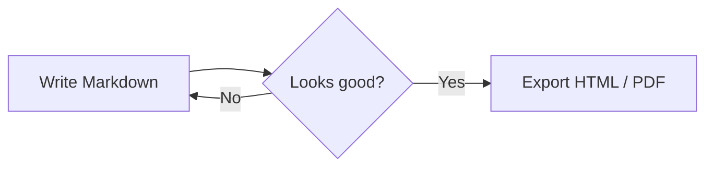

# Markdown Studio Showcase

This document uses every element from the [Markdown Guide](https://www.markdownguide.org/) so you can see how each one renders. Switch between **Editor**, **Split** and **Preview** with ⌘1, ⌘2 and ⌘3.

[TOC links work too: jump to the extended syntax](#extended-syntax)

## Basic Syntax

### Headings

# Heading level 1
## Heading level 2
### Heading level 3
#### Heading level 4
##### Heading level 5
###### Heading level 6

Alternate heading level 1
=========================

Alternate heading level 2
-------------------------

### Paragraphs and Line Breaks

I really like using Markdown.

I think I'll use it to format all of my documents from now on.

This is the first line.  
And this is the second line (two trailing spaces).

This line ends with an HTML break.<br>
So this one starts on a new line.

### Emphasis

I just love **bold text** and __bold text__.
Love**is**bold.

Italicized text is the *cat's meow* and the _cat's meow_.
A*cat*meow.

This text is ***really important*** and ___really important___ and __*really important*__ and **_really important_**.

### Blockquotes

> Dorothy followed her through many of the beautiful rooms in her castle.

> Dorothy followed her through many of the beautiful rooms in her castle.
>
> The Witch bade her clean the pots and kettles and sweep the floor and keep the fire fed with wood.

> Dorothy followed her through many of the beautiful rooms in her castle.
>
>> The Witch bade her clean the pots and kettles and sweep the floor and keep the fire fed with wood.

> #### The quarterly results look great!
>
> - Revenue was off the chart.
> - Profits were higher than ever.
>
>  *Everything* is going according to **plan**.

### Lists

1. First item
2. Second item
3. Third item
    1. Indented item
    2. Indented item
4. Fourth item

- First item
- Second item
- Third item
    - Indented item
    - Indented item
- Fourth item

* Asterisks work
* as list markers

+ And so do
+ plus signs

1968\. A great year! (escaped period, not a list)

#### Elements in Lists

* This is the first list item.
* Here's the second list item.

    I need to add another paragraph below the second list item.

* And here's the third list item.

1. Open the file.
2. Find the following code block on line 21:

        <html>
          <head>
            <title>Test</title>
          </head>

3. Update the title to match the name of your website.

### Code

At the command prompt, type `nano`.

``Use `code` in your Markdown file.``

    <html>
      <head>
      </head>
    </html>

### Horizontal Rules

***

---

_________________

### Links

My favorite search engine is [Duck Duck Go](https://duckduckgo.com "The best search engine for privacy").

<https://www.markdownguide.org>
<fake@example.com>

I love supporting the **[EFF](https://eff.org)**.
This is the *[Markdown Guide](https://www.markdownguide.org)*.
See the section on [`code`](#code).

In a hole in the ground there lived a hobbit. Not a nasty, dirty, wet hole, filled with the ends of worms and an oozy smell, nor yet a dry, bare, sandy hole with nothing in it to sit down on or to eat: it was a [hobbit-hole][1], and that means comfort.

[1]: <https://en.wikipedia.org/wiki/Hobbit#Lifestyle> "Hobbit lifestyles"

### Images


[](https://www.flickr.com/photos/beaurogers/31833779864/in/photolist-Qv3rFw-34mt9F-a9Cmfy-5Ha3Zi-9msKdv-o3hgjr-hWpUte-4WMsJ1-KUQ8N-deshUb-vssBD-6CQci6-8AFCiD-zsJWT-nNfsgB-dPDwZJ-bn9JGn-5HtSXY-6CUhAL-a4UTXB-ugPum-KUPSo-fBLNm-6CUmpy-4WMsc9-8a7D3T-83KJev-6CQ2bK-nNusHJ-a78rQH-nw3NvT-7aq2qf-8wwBso-3nNceh-ugSKP-4mh4kh-bbeeqH-a7biME-q3PtTf-brFpgb-cg38zw-bXMZc-nJPELD-f58Lmo-bXMYG-bz8AAi-bxNtNT-bXMYi-bXMY6-bXMYv)

### Escaping Characters

\* Without the backslash, this would be a bullet in an unordered list.

Characters you can escape: \\ \` \* \_ \{ \} \[ \] \< \> \( \) \# \+ \- \. \! \|

### HTML

This **word** is bold. This <em>word</em> is italic. Press <kbd>⌘</kbd> + <kbd>S</kbd> to save.

<details>
<summary>Click to expand</summary>

Raw HTML blocks are rendered as-is (scripts are stripped for safety).

</details>

## Extended Syntax

### Tables

| Syntax      | Description | Test Text     |
| :---        |    :----:   |          ---: |
| Header      | Title       | Here's this   |
| Paragraph   | Text        | And more      |
| `code`      | **bold**    | [link](#tables) |
| Pipe        | `\|` escaped | &#124; entity |

### Fenced Code Blocks

```
{
  "firstName": "John",
  "lastName": "Smith",
  "age": 25
}
```

### Syntax Highlighting

```json
{
  "firstName": "John",
  "lastName": "Smith",
  "age": 25
}
```

```swift
struct Greeting: View {
    var name: String
    var body: some View { Text("Hello, \(name)!") }
}
```

### Footnotes

Here's a simple footnote,[^1] and here's a longer one.[^bignote]

[^1]: This is the first footnote.

[^bignote]: Here's one with multiple paragraphs and code.

    Indent paragraphs to include them in the footnote.

    `{ my code }`

    Add as many paragraphs as you like.

### Heading IDs {#custom-id}

This heading has the custom ID `custom-id`, so [this link](#custom-id) jumps to it.

### Definition Lists

First Term
: This is the definition of the first term.

Second Term
: This is one definition of the second term.
: This is another definition of the second term.

### Strikethrough

~~The world is flat.~~ We now know that the world is round.

### Task Lists

- [x] Write the press release
- [ ] Update the website
- [ ] Contact the media

Click a checkbox in the preview to toggle it in the source.

### Emoji

Gone camping! :tent: Be back soon.

That is so funny! :joy:

### Highlight

I need to highlight these ==very important words==.

### Subscript and Superscript

H~2~O is a liquid. X^2^ is a square.

### Automatic URL Linking

https://www.markdownguide.org

### Disabling Automatic URL Linking

`https://www.example.com`

## Bonus

### Math

The quadratic formula is $x = \frac{-b \pm \sqrt{b^2 - 4ac}}{2a}$, and prices like $5 and $10 stay plain text.

$$
\int_0^\infty e^{-x^2}\,dx = \frac{\sqrt{\pi}}{2}
$$

### Diagrams


